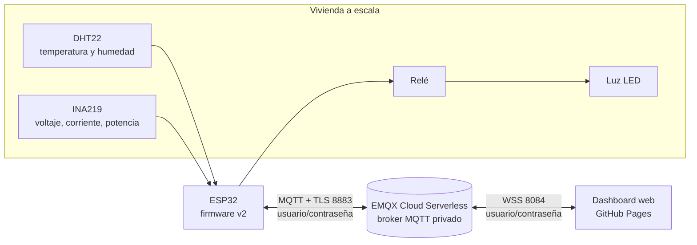

# Energía Casa — Sistema IoT de monitoreo y control del consumo energético

Trabajo final de **Internet de las Cosas** · Facultad de Ingeniería e Inteligencia Artificial · Grupo 5

Sistema basado en **ESP32** que mide en tiempo real el consumo eléctrico y las condiciones ambientales de una vivienda a escala, los envía de forma **segura** a la nube y permite **controlar la luz** desde un dashboard web. Si la potencia supera un límite, el sistema genera una alerta y **apaga la carga automáticamente**.

**Integrantes:** Callupe Oré, Joaquín Eduardo · Sifuentes Jiménez, Favio Alonso · Cardenas Ramirez, Renzo Adrian
**Profesor:** Alvarado Sandoval, Roberts Luis

---

## Arquitectura



| Tema MQTT | Dirección | Contenido |
|---|---|---|
| `grupo5iot/vivienda/energia/datos` | ESP32 → dashboard | Mediciones en JSON cada 2 s (retenido) |
| `grupo5iot/vivienda/energia/control` | dashboard → ESP32 | `ON`, `OFF`, `AUTO`, `MANUAL`, `LIMITE:<W>`, `RESET_ENERGIA` |
| `grupo5iot/vivienda/energia/ack` | ESP32 → dashboard | Confirmación o rechazo de cada comando |
| `grupo5iot/vivienda/energia/estado` | ESP32 → dashboard | `online` / `offline` (Last Will) |

## Funcionalidades

| Requerimiento | Implementación |
|---|---|
| RF01 Monitoreo eléctrico | INA219: voltaje, corriente, potencia (P = V × I) y energía acumulada (Wh) |
| RF02 Monitoreo ambiental | DHT22: temperatura y humedad, con reintento y tolerancia a lecturas fallidas |
| RF03 Transmisión inalámbrica | Wi-Fi + MQTT sobre TLS hacia un broker privado (EMQX Cloud) |
| RF04 Visualización | Dashboard web con maqueta animada, indicadores, gráficas y reporte |
| RF05/RF06 Sobreconsumo y alertas | Promedio móvil de potencia (arreglo de 3 lecturas) comparado con un límite configurable; alerta visual (LED + dashboard) e historial |
| RF07 Control de dispositivos | Encender/apagar la luz desde el dashboard con confirmación (ACK) |
| RF08 Automatización | Modo automático: corta la carga al superar el límite, incluso sin internet |
| RNF06 Seguridad | Ver [SECURITY.md](SECURITY.md) |

## Hardware y conexiones

| Componente | Pin | ESP32 |
|---|---|---|
| DHT22 | DATA / VCC / GND | GPIO 4 / 3V3 / GND |
| INA219 | SDA / SCL / VCC / GND | GPIO 21 / GPIO 22 / 3V3 / GND |
| Relé | IN / VCC / GND | GPIO 19 / +5 V del cargador / GND común |
| LED de alerta | ánodo (con 220 Ω) | GPIO 18 |

Circuito de la luz (5 V de un cargador USB):
`+5 V → VIN+ (INA219) → VIN− → COM (relé) → NO → 220 Ω → LED → GND`

> Todas las tierras (cargador, ESP32, relé y luz) deben estar unidas.
> El relé se alimenta con 5 V y el ESP32 trabaja a 3,3 V: el firmware suelta el relé dejando el pin como entrada, por eso funciona sin transistor adicional.

## Puesta en marcha

### 1. Broker privado (EMQX Cloud Serverless, gratis)
1. Crear una cuenta en [cloud-intl.emqx.com](https://cloud-intl.emqx.com) y una implementación **Serverless** dejando el límite de gasto mensual en **0** (así es gratis).
2. En **Access Control → Authentication** agregar dos usuarios:
   - `esp32-grupo5` → lo usa la placa
   - `dashboard-grupo5` → lo usan las personas en el dashboard
3. (Recomendado) En **Access Control → Authorization** limitar cada usuario a los temas `grupo5iot/vivienda/energia/#`.
4. Copiar la **dirección** del broker de la pestaña *Overview* (termina en `.emqxsl.com`).

> También funciona con **HiveMQ Cloud** (dominio `.hivemq.cloud`): el firmware y el dashboard detectan el proveedor. HiveMQ dejó de crear clusters Serverless gratuitos en 2026.

### 2. Firmware del ESP32
1. Instalar en el Arduino IDE la placa **esp32 by Espressif Systems** y las librerías **DHT sensor library**, **Adafruit Unified Sensor**, **Adafruit INA219** y **PubSubClient**.
2. En `firmware/sistema_energia/` copiar `secrets.example.h` como **`secrets.h`** y completar Wi-Fi, dirección del broker, usuario y contraseña del ESP32.
   `secrets.h` está en `.gitignore`: **nunca se sube a GitHub**.
3. Abrir `sistema_energia.ino`, elegir **ESP32 Dev Module** y subir.
4. En el Monitor Serie (115200) debe aparecer `[MQTT] Conectando a ... (TLS)... OK`.

Parámetros como pines, límite inicial y si la luz está en el borne NC se ajustan en `config.h`.

### 3. Dashboard
- **En línea:** `Settings → Pages → Deploy from a branch → main / docs`. Queda en `https://<usuario>.github.io/<repo>/`.
- **Local:** abrir `docs/index.html` en el navegador.

Iniciar sesión con la dirección del broker y el usuario `dashboard-grupo5`. Para que la dirección aparezca precargada, escribirla en `docs/config.js`.

## Guion de demostración
1. **Monitoreo:** al iniciar sesión aparecen las mediciones eléctricas y ambientales.
2. **Control:** *Encender / Apagar*; la luz de la maqueta y la del dashboard cambian y llega la confirmación del ESP32.
3. **Ambiente:** soplar aire tibio al DHT22 y ver la gráfica subir.
4. **Sobreconsumo:** fijar un límite menor que el consumo de la luz y encenderla: el sistema la corta solo, se enciende el LED de alerta y el evento queda registrado.
5. **Reporte:** descargar el CSV de la sesión.
6. **Seguridad:** intentar entrar con una contraseña incorrecta (es rechazada) y mostrar el candado TLS.

## Estructura

```
firmware/sistema_energia/
  sistema_energia.ino   programa principal
  config.h              pines, temas y parámetros (público)
  certificado.h         certificados raíz para verificar el broker (TLS)
  secrets.example.h     plantilla de credenciales (copiar a secrets.h)
docs/                   dashboard web (GitHub Pages)
  index.html · styles.css · app.js · config.js
  vendor/mqtt.min.js    MQTT.js 5.10.1 (MIT), servido localmente
.github/workflows/      compilación automática del firmware
```
